## Ramirez Azul NC 0441 
## NL 47 -- Naranja y Morado
## imagenes preparadas Colores naranja
# 1 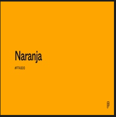
# 2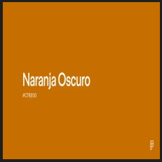
# 3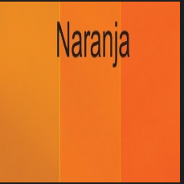
# 4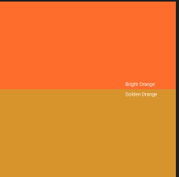
# 5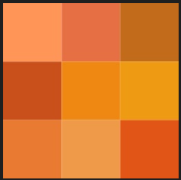

## imagenes preparadas Colores morado
# 1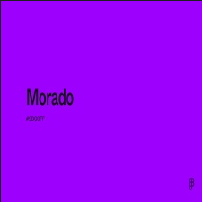
# 2
# 3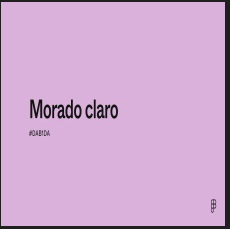
# 4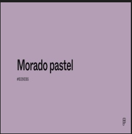
# 5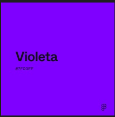

## resultado terminal
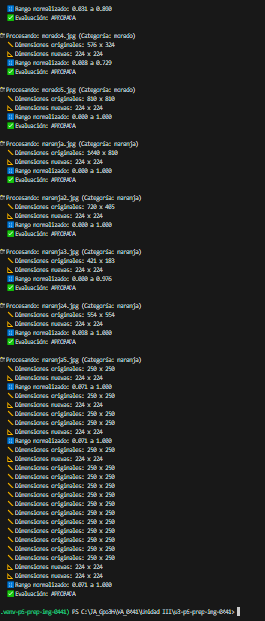

## estructura de carpetas
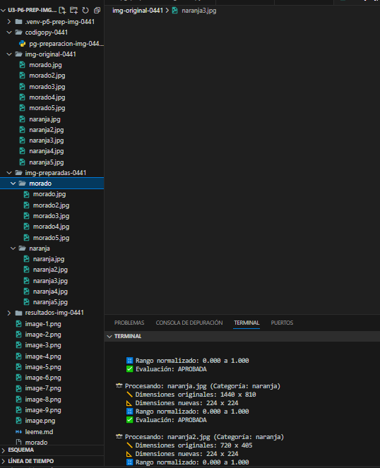
